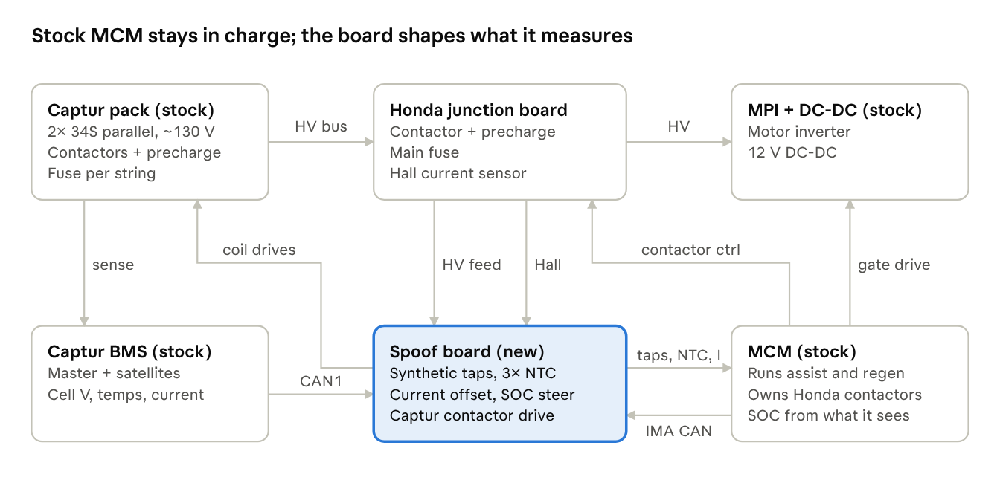
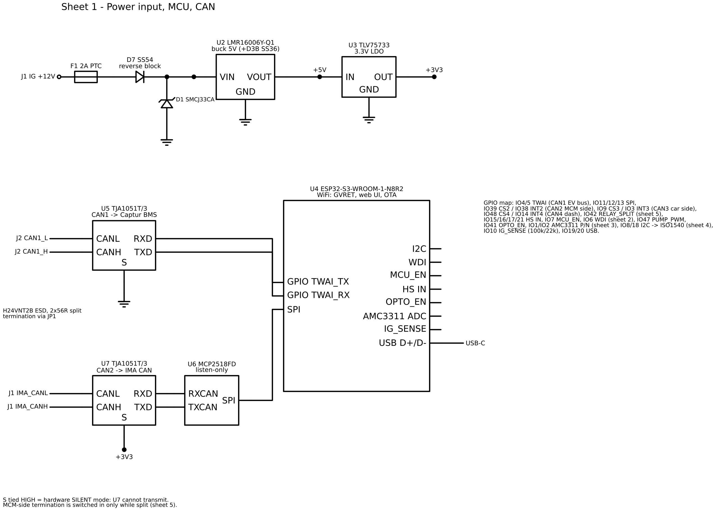
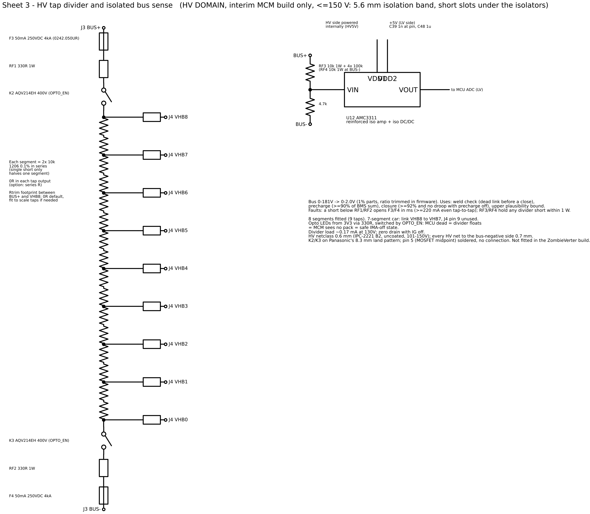
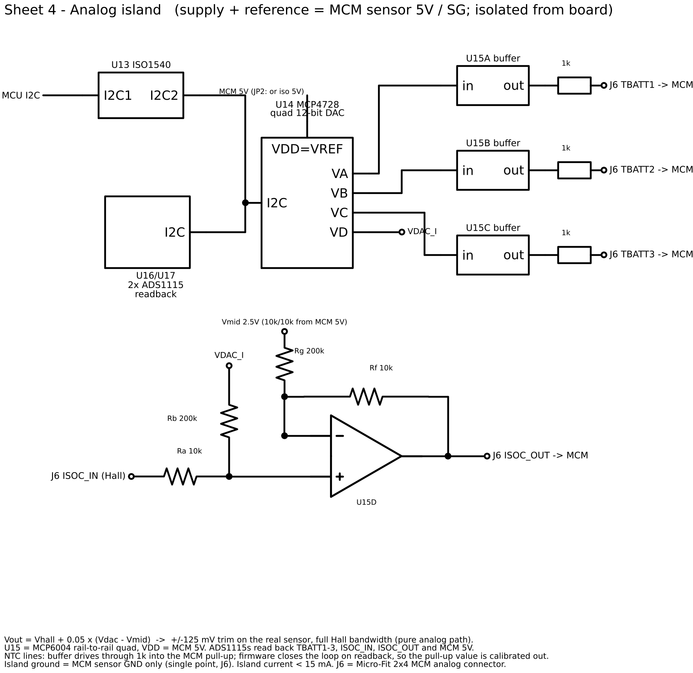
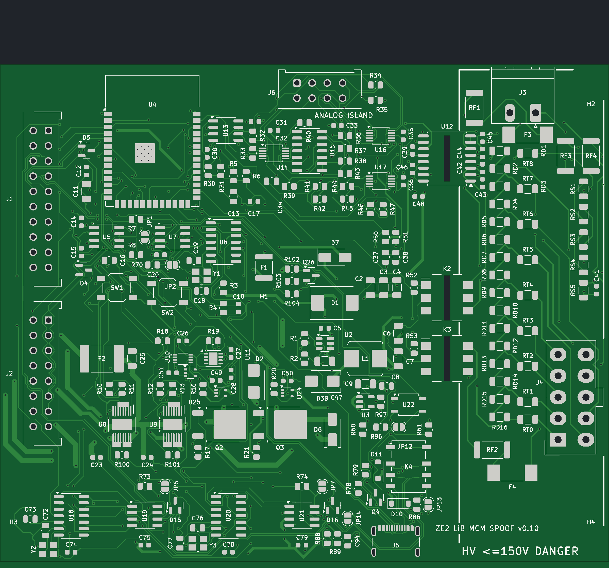

# ZE2 Captur MCM spoof board

A man-in-the-middle board that lets a stock Honda Insight ZE2 run on a Renault Captur E-Tech
lithium pack. The stock MCM stays in charge; the board only changes what it measures: cell taps,
pack temperatures and the current-sensor signal. It also sits on the car's CAN buses. Later,
with the MCM removed, the same board becomes the CAN gateway for a ZombieVerter and a Toyota
inverter.

<p align="center">
  
</p>

> **Status: untested design, v0.10.** No boards have been made. v0.6, v0.7 and v0.10 fold in three design reviews;
> v0.8 lets the board measure or cope with the remaining unknowns itself; v0.9 moved the routing to
> [KiCadRoutingTools](https://github.com/drandyhaas/KiCadRoutingTools). Bring-up and vehicle checks are in
> [docs/BRINGUP.md](docs/BRINGUP.md). Several parts are placeholders (listed
> [below](#before-ordering)). The BOM carries LCSC numbers, Basic or Preferred wherever JLC has one. The design was
> produced with an AI assistant from my brief and is up for review ([feedback](#feedback) welcome).
> Don't connect it to a pack on the strength of this README.

| | |
|---|---|
| Car | Honda Insight ZE2 (JDM), stock IMA: MCM, MPI, DC-DC, junction board |
| Pack | Renault Captur E-Tech 1.2 kWh, 68S (2 x 34S), own master/satellite BMS and contactors |
| Stage 1 | modules in parallel, 34S2P, about 130 V; stock MCM fed spoofed signals |
| Stage 2 | 68S, about 260 V, MCM removed, ZombieVerter V1 + Toyota inverter (OpenInverter logic board) |
| MCU | ESP32-S3-WROOM-1-N8R2 (8 MB flash, Wi-Fi: SavvyCAN streaming over GVRET, OTA updates) |
| CAN | 4 buses: CAN1 EV (TWAI), CAN2/CAN3 the MCM and PCM halves of the IMA bus, CAN4 dash tap (MCP2518FD each, 32-frame receive FIFO) |
| Spoofing | 9 cell taps (resistor divider off the real pack bus), 3 NTC lines (DAC + op-amps), Hall current offset (+/-125 mV) |
| Contactors | Captur contactors and precharge driven by the board: high-side drivers + low-side master FET behind a watchdog-cleared enable latch |
| HV side | stage 1 only, rated 150 V, 5.6 mm copper-free band, short slots under the three isolation parts |
| Board | 120 x 98 mm, 4 layers, 1.6 mm, parts on top |

## How it works

<p align="center"></p>

- **Cell taps:** a resistor divider fed from the real pack bus (through a 250 V DC fuse and 330 ohm at
  each end, switched by two optoMOS) gives the MCM nine balanced taps. The taps are switched on only once
  the contactors are verified closed and the analog island is answering. If the board loses power the
  optoMOS open, the taps float and the MCM sets the IMA light and stops using the pack.
- **Temperatures:** a DAC and op-amp buffers drive the three NTC lines, mapping the Captur
  temperatures onto the Honda curve.
- **SOC:** a small DAC offset added to the Hall sensor signal nudges the MCM's own coulomb count to
  track the real pack, so it stops regen near full and assist near empty by itself.
- **Analog island:** the DAC, op-amps and readback ADCs run from the MCM's 5 V sensor supply,
  isolated from the rest by an I2C isolator, so everything is ratiometric to the MCM.
- **Captur contactors:** closed by the board at key-on, before the MCM looks at the pack. An
  AMC3311 isolated amplifier (with its own isolated supply) on the bus checks precharge and
  contactor welding.
- **CAN:** CAN2 and CAN3 split the IMA bus. A DPDT relay (K4) joins the halves whenever the board is
  unpowered. Each split half can be terminated at the board end by a 120 ohm resistor, connected
  only while K4 is energised: the PCM side through K4's spare normally-open contacts, the MCM side
  through a photoMOS driven alongside the coil. Each has a solder jumper, open by default; measure
  CANH-CANL on each half with the bus split (about 120 ohm: close it; about 60 ohm: leave it).
  CAN4 is a plain tap on the dash bus. CAN2-4 transceivers stay in hardware silent mode until a
  solder jumper is closed. Bypass is the factory setting (`mitm` off in NVS); when splitting is enabled,
  K4 is energised only after both CAN controllers confirm normal mode, and a hung control loop is reset by
  the task watchdog, which releases K4.
- **Protection:** steer SOC first; then float the tap divider so the MCM faults; last, open the
  Captur contactors. The master enable is a flip-flop that the firmware's watchdog kicks clock
  in; if the firmware hangs the watchdog clears it. A stall is a latched fault: nothing closes again
  until a key-off, which the ADC reads with hysteresis and a 2 s dwell so a crank dip doesn't count.
  Contactor, sensing and weld faults all end the same way, as does losing the ignition reading for
  0.5 s. A reset while running (brownout, watchdog, panic) starts tripped and stays so until the next
  power cycle. No regen below about 5 C.
- **Closing the contactors:** the Captur has two, main+ and precharge; pack negative is hard-wired. With
  both coils off the link (watched by the AMC3311) must be dead, which rules out a weld. Then precharge,
  then main+ with precharge still held until it has picked up, then precharge off for 300 ms: the link
  must hold at the pack voltage. A charged link reads ~100 % with main+ open too, so the check is that it
  doesn't decay (calibrated on the bench, [BRINGUP](docs/BRINGUP.md)). The close aborts, latched, on a
  precharge deadline, a link reading above the pack, or a soft trip before it finishes. A soft trip keeps a
  closed pack closed but never starts a close.
- **Captur BMS:** kept awake by the 0x0F5 frame every 20 ms (counter + CRC-8) and read with UDS (29-bit,
  read-only) for the extreme cells, the cell sum, temperatures and SOC, as decoded on the bench. The
  precharge target is the cell sum scaled to the series string (half of it in 34S2P), and the sum must
  agree with 68 x the extreme cells.
- **If the board dies:** the IMA bus rejoins and the dash is unaffected, but the pack drops out on
  purpose. The car runs engine-only with the IMA light, and the 12 V battery isn't charged (the
  DC-DC runs off the pack).

## Schematic

Block-level sheets with the key part values, drawn by [`docs/schematic.py`](docs/schematic.py).
The netlist itself is [`hw/parts.json`](hw/parts.json), written by
[`hw/build_board.py`](hw/build_board.py).

<details>
<summary><b>The five sheets</b></summary>







</details>

## Circuit board

The HV strip is on the right. Only three parts cross the gap to it, and each is an isolation part:
the two AQV214EH optoMOS (K2, K3) and the AMC3311 (U12). There is a
1.2 mm slot under each of those, where dirt or flux trapped under the body could bridge pads. At
150 V or less the 5.6 mm band gives enough creepage without a slot elsewhere. The pack terminal
J3 overhangs the top edge with its wire entry facing out, and the USB-C face sits about 0.85 mm past the bottom edge.

<p align="center">
  
  
</p>

## Before ordering

- Pinouts to check against datasheets: VND7050AJ (custom PowerSSO-16 footprint in `hw/lib`),
  TPS3431, SN74LVC1G74 and SN74LVC1G17 (watchdog latch), SN74LV1T34 (5 V gate buffers), AMC3311, AQY212GS,
  H24VNT2B, and the SMMS0630 inductor on the SRP7028A land pattern.
- Land patterns drawn from datasheet dimensions (`hw/lib/ze2.pretty`): the AQV214EHA (Panasonic's 1.5 x 1.9 mm
  lands on 8.3 mm rows) and the Littelfuse 242 fuse (end-cap lands sized from the 3.0 x 8.4 mm body: check
  against Littelfuse's drawing).
- The Captur coils are measured: main 22.8 ohm (0.535 A at 12 V, pulls in at 5.5 V), precharge about
  56 ohm (0.2 A, 6.8 V), so the coil path carries under 0.8 A. Pump: any 12 V pump under about 3 A
  (see [Pump](#pump)); nothing to measure before ordering.
- Wire the pack as below (the coils have no internal diode, so driving them from the high side with the
  common pin 7 on the return is fine).
- K4: beep-test a G6K-2F-Y before fitting. Pins 3/6 must be the commons (IMA side), 2/7 the
  normally-closed contacts (MCM side).
- AMC3311 stock at JLC is low: check before ordering, or fit by hand.
- Check rotations in JLC's placement preview, especially U8/U9 (custom footprint).
- Conformal-coat the HV strip. Every HV-class net (bus, ladder, taps, sense chain) keeps 0.7 mm from the
  bus-negative side by a DRC rule (`hw/ze2-mcm-spoof.kicad_dru`); IPC-2221 B2 asks 0.6 mm uncoated at 101-150 V.
  Creepage across the assembled parts, the harness and the enclosure still needs checking on the built unit.
- J5 (USB-C): KiCad's footprint puts the peg holes 0.19 mm from pads A/B. Common on JLC boards, but check
  their NPTH-to-copper rule when ordering.
- Check the Captur BMS protects both parallel strings in 34S2P.
- Nothing on the car or the pack needs measuring before ordering. What used to be on this list is now
  handled by the board itself:
  - NTC pull-ups: measured by the board at each start-up and trimmed by readback (only the Honda sensor's
    curve is assumed; check it against the MCM's reported battery temperature in the first log).
  - Tap input impedance: the tap ladder is 10k (0.13 W), so even a 1 Mohm MCM input shifts a block by
    under 4 %. To check it anyway: ohms from each VHB pin to VHB0 at the MCM connector, MCM unplugged.
  - Hall sensor zero and scale: not needed. SOC steering is closed-loop on the MCM's own SOC.
  - IMA bus log: the board logs it in bypass mode (SavvyCAN over Wi-Fi), with nothing transmitted.
  - Bus-sense divider: 1 % parts and a 92 % close check, so no meter trim is needed (`HV_DIV_X1000` is
    there if you want one).
  - The link's bleed time constant, which the open-main check relies on: measured on the bench before the car
    ([BRINGUP](docs/BRINGUP.md)).

### Pump

Choose the pump later; the board handles the common kinds without changes, set in NVS (`pump_mode`):

| Pump | Wiring on J2 | `pump_mode` |
|---|---|---|
| 2-wire, brushless (most cheap 12 V pumps, OEM inverter pumps) | + to 13, - to 14 | 0, on/off (default) |
| 2-wire, brushed | + to 13, - to 14 | 1, PWM at 20 kHz |
| 3-wire PWM (Bosch-style signal input) | + to 13, ground to a spare GND, signal to 14 | 2, signal at 100 Hz (`pump_hz`, `pump_inv`) |

Keep it under about 3 A: F2 (5 A) also feeds the coils. The board reads the pump line back through a threshold
FET (R102/R103 into Q26's gate, Q26 pulling GPIO35 low), so the GPIO never sees the 12-16 V line, and it reports
an open circuit, a failed Q3, or a 3-wire pump that isn't pulling its signal up.

### Captur LV connector to J2

| Captur pin | Function | J2 pin (net) |
|---|---|---|
| 1 | BMS +12 V | 5 (BMS12V) |
| 6, 12 | Ground | 3, 4, 8 (GND) |
| 5 / 10 | CAN H / CAN L | 6 / 7 (CAN1H / CAN1L) |
| 8 | HVIL loop: link to pin 12, as on the bench | - |
| 7 | Common of both coils | 12 (COIL_RTN) |
| 3 | Precharge coil | 9 (COIL_PRE) |
| 4 | Main coil | 10 (COIL_MAINP) |
| - | (spare high side; no main- contactor) | 11 (COIL_MAINN), leave open |

## Ordering at JLCPCB

[`hw/out/jlc/`](hw/out/jlc/) has the gerbers, BOM and CPL. The BOM picks are in
[`hw/jlc_parts.py`](hw/jlc_parts.py) and [`cost.md`](hw/out/jlc/cost.md) has the estimate: about $53 of
parts per board (cost.md has the current figures; Standard charges $1.53 for every Basic and Extended type,
Economic $3.07 per Extended type). Order Standard PCBA with everything fitted: the ESP32-S3 module needs it, and
the CPL includes the five Molex/Phoenix connectors at their body centres for JLC's THT assembly (check pin 1 and
the mating side in JLC's preview). The AQV214EH optoMOS isn't stocked at JLC: global-source it. The TPS3431-Q1
(TPS3431SQDRBRQ1, C2878091) has low LCSC stock: get it allocated before ordering. Ask JLC for separate 2- and
5-board fully assembled quotes to see the fixed costs. The only passives kept
Extended on purpose are the 0.1 % tap-ladder resistors, which set how evenly the MCM sees the blocks.

## Firmware

ESP-IDF firmware in [`firmware/`](firmware/), which builds cleanly but hasn't run on a board yet. It
covers all four CAN buses, the IMA man-in-the-middle, the spoofing, contactor sequencing and the
protection ladder. It also streams everything to SavvyCAN over Wi-Fi (GVRET) and takes firmware updates
over Wi-Fi with rollback, accepted only with the ignition off and the contactors open. SavvyCAN can only
transmit in that state too.

A simulation build runs the real firmware against modelled buses and MCP2518FDs on Espressif's ESP32-S3
QEMU, with all four buses up to 100 % load. No frames are lost at realistic loads, where core 1 (CAN)
runs at 22-70 % and core 0 at 18-37 %; with every bus saturated on the slow CPU model it is at the edge. See [`firmware/README.md`](firmware/README.md) for the
numbers.

## Building from source

Everything is generated by scripts in `hw/`; edit the scripts, not the KiCad files. With KiCad 7's Python
(`pcbnew` importable) and a [KiCadRoutingTools](https://github.com/drandyhaas/KiCadRoutingTools) checkout with
its router built, one command rebuilds the board, the JLC files, the images and runs the tests:

```
KRT_DIR=<KiCadRoutingTools checkout> hw/build.sh        # ECO: keeps unchanged copper, re-routes the rest (minutes)
KRT_DIR=<KiCadRoutingTools checkout> hw/build.sh full   # routes everything from scratch (~30 min)
```

Add `RENDER=1` for the ray-traced renders (`pip install bpy`; `KICAD_3D_DIRS=<kicad 9 3dmodels>:<kicad 7 3dmodels>`).
The steps it runs, from `hw/`:

| Step | Command |
|---|---|
| net classes, custom rules | `python3 project.py ze2-mcm-spoof` |
| netlist + placement | `python3 build_board.py build/unrouted.kicad_pcb` (also writes `parts.json`) |
| route | `python3 krt_route.py build/unrouted.kicad_pcb build/routed.kicad_pcb [ze2-mcm-spoof.kicad_pcb]`: the USB and CAN pairs coupled, the crystal nets first on F.Cu, then the rest at real track widths; JLC standard rules, no via in or touching an SMD pad, keep-out on the HV band; anything left incomplete gets a finishing pass that may use In1 (GND plane) at a high cost. With the last argument only nets whose pads changed, whose copper touches a changed part, or that were incomplete are re-routed |
| dangling copper | `python3 cleanup.py build/routed.kicad_pcb` until it prints nothing |
| coil/pump copper | `python3 widen_power.py build/routed.kicad_pcb build/finished.kicad_pcb` (1.0 mm where DRC allows, else 0.75 mm) |
| silkscreen | `python3 tidy_silk.py build/finished.kicad_pcb build/tidy.kicad_pcb` |
| planes, DRC, JLC files | `python3 fab.py build/tidy.kicad_pcb ze2-mcm-spoof.kicad_pcb out/jlc` (LCSC picks from `jlc_parts.py`) |
| layer images | `python3 photo_render.py ze2-mcm-spoof.kicad_pcb ../docs/img/layers` |
| 3D render | `EXPORT_DIR=scene xvfb-run -a python3 render3d.py ze2-mcm-spoof.kicad_pcb ../docs/img/layers_top.png x`, then `python3 blender_render.py scene/scene.json ../docs/img/board 64 1800` |
| schematic sheets | `python3 ../docs/schematic.py` |
| tests | `python3 -m pytest` (from the repo root) |

The tests check: KiCad DRC is clean apart from two accepted items (footprint-library notices, and
the USB-C peg holes in KiCad's own footprint); no copper in the HV band except the three isolation
parts; slots only under those parts; J3 and USB-C overhangs; the antenna keep-out; silkscreen text size; the
CAN termination, bypass relay contacts, watchdog latch, 5 V gate drive, driver input pins and reverse
protection in the netlist; the full-bus 0.7 mm rule; the JLC files against the board, with an LCSC number on
every line and Basic/Preferred passives; and the firmware against the hardware (GPIO map, CAN clock and
bit timing, crystal load caps, HV divider scale, ADC1 inputs). `tests/host/` compiles the firmware's
safety chain (BMS decode, safety ladder, contactor sequencer, ignition) with gcc against a model of the
contactors, the watchdog latch and the bus sense, and runs 23 scenarios: a normal close, welds, main+ stuck open
(with the link partly and fully charged), a soft trip or an implausibly high link mid-close, a late precharge,
sensor loss (bus and ignition), a loop stall and resume, crank dips, a reset while running, island loss, a
millisecond-counter wrap, stale or inconsistent BMS data. 9 more cover the pump drive, the NTC lines and the
island-health report.

| Folder | Contents |
|---|---|
| `hw/` | generators, build script, KiCad board and project, `parts.json` netlist |
| `hw/out/` | JLC gerbers, BOM, CPL and the DRC report |
| `firmware/` | ESP-IDF firmware, simulation build and its results (`firmware/sim/out/`) |
| `docs/` | schematic script and the README images |
| `tests/` | pytest checks |

## Feedback

Issues and pull requests welcome, especially from anyone who has done IMA or OpenInverter work.
Criticism of the whole approach is fine too.

To get an AI assistant to review the design, give it [`docs/AI_REVIEW_BRIEF.md`](docs/AI_REVIEW_BRIEF.md)
and access to this repo.

## Licence

- **Hardware** (everything in `hw/`, including the scripts that generate the board, and the images):
  [CERN-OHL-P-2.0](LICENSES/CERN-OHL-P-2.0.txt).
- **Software** (tests and image scripts): [MIT](LICENSES/MIT.txt).

No warranty. This connects to a high-voltage traction pack; building and using it is at your own risk.
