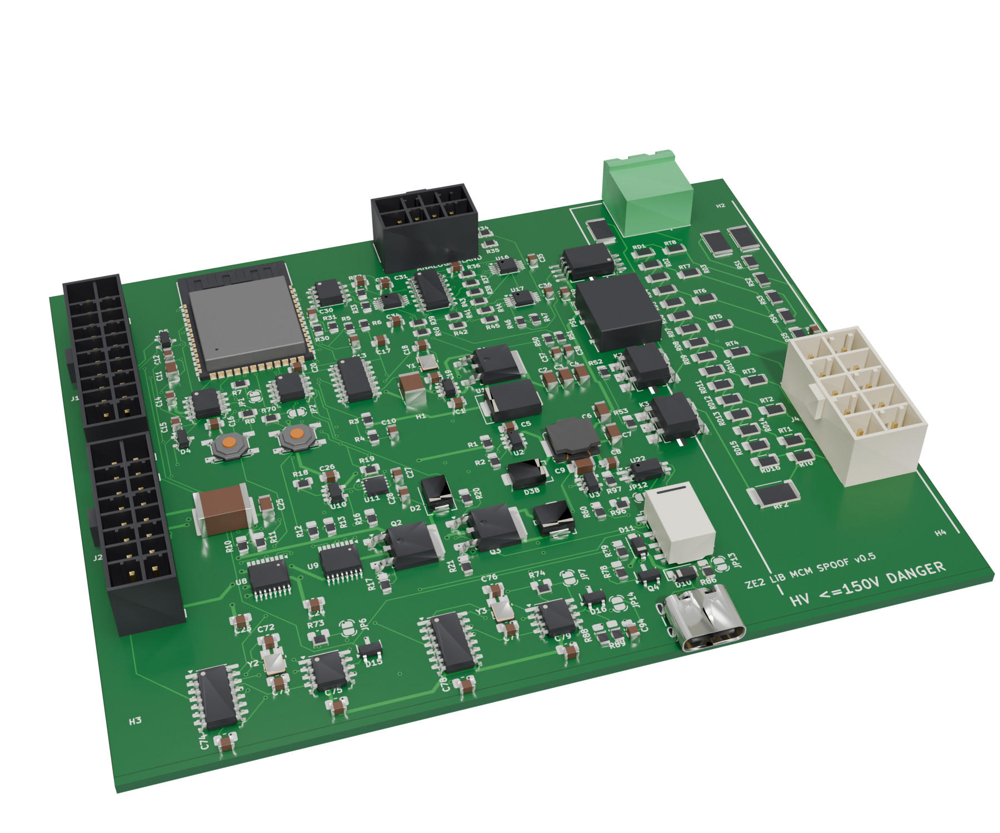
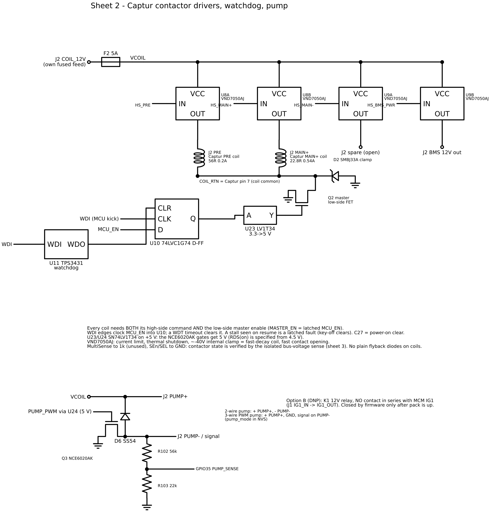
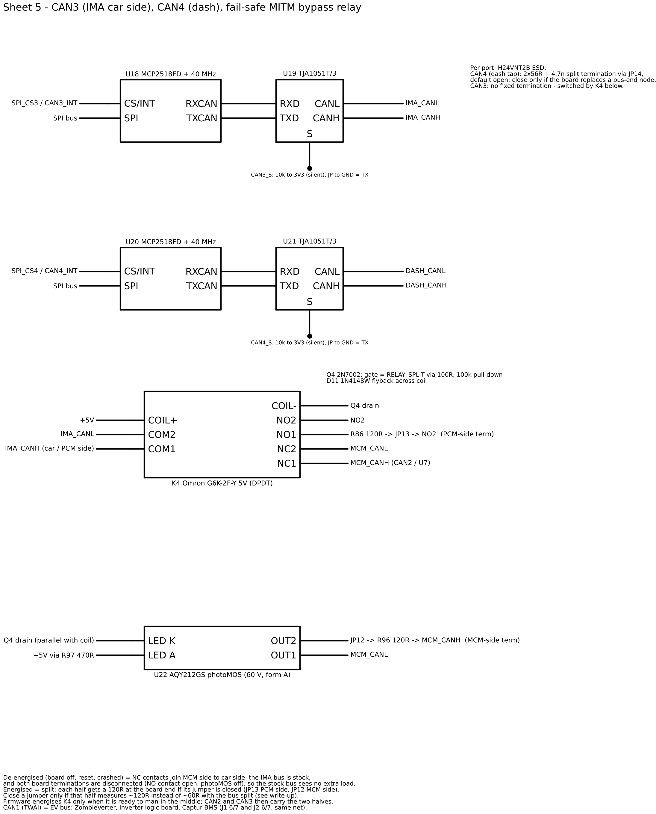
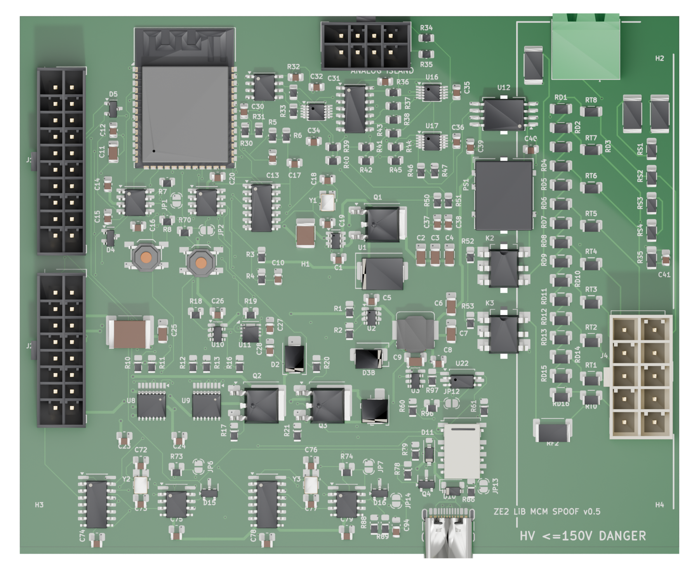

# ZE2 Captur MCM spoof board

A man-in-the-middle board that lets a stock Honda Insight ZE2 run on a Renault Captur E-Tech
lithium pack. The stock MCM stays in charge; the board only changes what it measures: cell taps,
pack temperatures and the current-sensor signal. It also sits on the car's CAN buses. Later,
with the MCM removed, the same board becomes the CAN gateway for a ZombieVerter and a Toyota
inverter.

  

> **Status: untested design.** No boards have been made. Several parts are placeholders (listed
> [below](#before-ordering)). The BOM carries LCSC numbers, Basic or Preferred wherever JLC has one. The design was
> produced with an AI assistant from my brief and is up for review ([feedback](#feedback) welcome).
> Don't connect it to a pack on the strength of this README.

| | |
|---|---|
| Car | Honda Insight ZE2 (JDM), stock IMA: MCM, MPI, DC-DC, junction board |
| Pack | Renault Captur E-Tech 1.2 kWh, 68S (2 x 34S), own master/satellite BMS and contactors |
| Stage 1 | modules in parallel, 34S2P, about 130 V; stock MCM fed spoofed signals |
| Stage 2 | 68S, about 260 V, MCM removed, ZombieVerter V1 + Toyota inverter (OpenInverter logic board) |
| MCU | ESP32-S3-WROOM-1-N8R2 (8 MB flash, Wi-Fi: SavvyCAN streaming over GVRET, OTA updates) |
| CAN | 4 buses: CAN1 EV (TWAI), CAN2/CAN3 the MCM and PCM halves of the IMA bus, CAN4 dash tap (MCP2518FD each, 32-frame receive FIFO) |
| Spoofing | 9 cell taps (resistor divider off the real pack bus), 3 NTC lines (DAC + op-amps), Hall current offset (+/-125 mV) |
| Contactors | Captur contactors and precharge driven by the board: high-side drivers + low-side master FET behind a window watchdog |
| HV side | stage 1 only, rated 150 V, 5.6 mm copper-free band, short slots under the four isolation parts |
| Board | 120 x 98 mm, 4 layers, 1.6 mm, parts on top |

## How it works

- **Cell taps:** a resistor divider fed from the real pack bus (fused, switched by two optoMOS)
  gives the MCM nine balanced taps. If the board loses power the optoMOS open, the taps float and
  the MCM sets the IMA light and stops using the pack.
- **Temperatures:** a DAC and op-amp buffers drive the three NTC lines, mapping the Captur
  temperatures onto the Honda curve.
- **SOC:** a small DAC offset added to the Hall sensor signal nudges the MCM's own coulomb count to
  track the real pack, so it stops regen near full and assist near empty by itself.
- **Analog island:** the DAC, op-amps and readback ADCs run from the MCM's 5 V sensor supply,
  isolated from the rest by an I2C isolator, so everything is ratiometric to the MCM.
- **Captur contactors:** closed by the board at key-on, before the MCM looks at the pack. An
  AMC1311 isolated amplifier on the bus checks precharge and contactor welding.
- **CAN:** CAN2 and CAN3 split the IMA bus. A DPDT relay (K4) joins the halves whenever the board is
  unpowered. Each split half can be terminated at the board end by a 120 ohm resistor, connected
  only while K4 is energised: the PCM side through K4's spare normally-open contacts, the MCM side
  through a photoMOS driven alongside the coil. Each has a solder jumper, open by default; measure
  CANH-CANL on each half with the bus split (about 120 ohm: close it; about 60 ohm: leave it).
  CAN4 is a plain tap on the dash bus. CAN2-4 transceivers stay in hardware silent mode until a
  solder jumper is closed.
- **Protection:** steer SOC first; then float the tap divider so the MCM faults; last, open the
  Captur contactors (in hardware if the firmware hangs). No regen below about 5 C.
- **If the board dies:** the IMA bus rejoins and the dash is unaffected, but the pack drops out on
  purpose. The car runs engine-only with the IMA light, and the 12 V battery isn't charged (the
  DC-DC runs off the pack).

## Schematic

Block-level sheets with the key part values, drawn by [`docs/schematic.py`](docs/schematic.py).
The netlist itself is [`hw/parts.json`](hw/parts.json), written by
[`hw/build_board.py`](hw/build_board.py).

<b>The five sheets</b>

## Circuit board

The HV strip is on the right. Only four parts cross the gap to it, and each is an isolation part:
the two AQV214EH optoMOS (K2, K3), the AMC1311 (U12) and the isolated DC-DC (PS1). There is a
1.2 mm slot under each of those, where dirt or flux trapped under the body could bridge pads. At
150 V or less the 5.6 mm band gives enough creepage without a slot elsewhere. The pack terminal
J3 overhangs the top edge with its wire entry facing out, and the USB-C face sits about 0.85 mm past the bottom edge.

  
  

## Before ordering

- Placeholders to check against datasheets: VND7050AJ drivers (stand-in footprint, assumed
  pinout), TPS3431 watchdog, LM74700 ideal-diode controller, the isolated DC-DC footprint (R1SX-0505
  on a Murata NXE stand-in), the K4 relay pin map (COM must be the PCM side), the AQY212GS and
  H24VNT2B pinouts, and the SMMS0630 inductor on the SRP7028A land pattern.
- Check rotations in JLC's placement preview.
- Measure the stock car first: tap input impedance, NTC pull-ups, Hall sensor zero and scale, and a
  SavvyCAN log of the IMA bus.
- Trim `HV_DIV_X1000` in `firmware/main/config.h` against a meter on the pack: the bus-sense divider
  uses 1 % Basic parts.

## Ordering at JLCPCB

[`hw/out/jlc/`](hw/out/jlc/) has the gerbers, BOM and CPL. The BOM picks are in
[`hw/jlc_parts.py`](hw/jlc_parts.py) and [`cost.md`](hw/out/jlc/cost.md) has the estimate: about $50 of
parts per board and 23 Extended SMT part types ($3 loading fee each). Fit the five Molex/Phoenix
connectors by hand to save another $15 of fees. Three parts aren't stocked at JLC (AQV214EH optoMOS,
TPS3431 watchdog, R1SX-0505 DC-DC): use JLC global sourcing or fit them by hand. The only passives kept
Extended on purpose are the 0.1 % tap-ladder resistors, which set how evenly the MCM sees the blocks.

## Firmware

ESP-IDF firmware in [`firmware/`](firmware/), which builds cleanly but hasn't run on a board yet. It
covers all four CAN buses, the IMA man-in-the-middle, the spoofing, contactor sequencing and the
protection ladder. It also streams everything to SavvyCAN over Wi-Fi (GVRET) and takes firmware updates
over Wi-Fi with rollback, accepted only with the ignition off and the contactors open.

A simulation build runs the real firmware against modelled buses and MCP2518FDs on Espressif's ESP32-S3
QEMU, with all four buses up to 100 % load. No frames are lost in any case; at realistic loads core 1
(CAN) runs at 22-68 % and core 0 at 18-39 %. See [`firmware/README.md`](firmware/README.md) for the
numbers.

## Building from source

Everything is generated by scripts in `hw/`; edit the scripts, not the KiCad files. Run from `hw/`
with KiCad 7's Python (`pcbnew` importable).

| Step | Command |
|---|---|
| netlist + placement | `python3 build_board.py unrouted.kicad_pcb` (also writes `parts.json`) |
| route | `python3 route.py unrouted.kicad_pcb routed.kicad_pcb`, then `finish.py` and `postfix.py` |
| later changes (ECOs on the routed board) | `eco_v04_terminations.py`, `eco_v04_route.py`, `eco_v04_j3_slots.py`, `eco_v04_usb.py`, `eco_v05_jlc.py` (MCP2518FD, JLC part swaps) |
| silkscreen | `python3 tidy_silk.py routed.kicad_pcb tidy.kicad_pcb` |
| planes, DRC, JLC files | `python3 fab.py tidy.kicad_pcb ze2-mcm-spoof.kicad_pcb out/jlc` (LCSC picks from `jlc_parts.py`) |
| layer images | `python3 photo_render.py ze2-mcm-spoof.kicad_pcb ../docs/img/layers` |
| 3D render | `EXPORT_DIR=scene KICAD_3D_DIRS=<kicad 9 3dmodels>:<kicad 7 3dmodels> xvfb-run -a python3 render3d.py ze2-mcm-spoof.kicad_pcb ../docs/img/layers_top.png x`, then `python3 blender_render.py scene/scene.json ../docs/img/board 64 1800` (`pip install bpy`) |
| schematic sheets | `python3 docs/schematic.py` |
| tests | `python3 -m pytest` (from the repo root) |

The tests check: KiCad DRC is clean apart from two accepted items (footprint-library notices, and
the USB-C peg holes in KiCad's own footprint); no copper in the HV band except the four isolation
parts; slots only under those parts; J3 and USB-C overhangs; the antenna keep-out; silkscreen text size; the
CAN termination and bypass wiring in the netlist; the JLC files against the board, with an LCSC number on
every line and Basic/Preferred passives; and the firmware against the hardware (GPIO map, CAN clock and
bit timing, crystal load caps, HV divider scale).

| Folder | Contents |
|---|---|
| `hw/` | generators, router, KiCad board and project, `parts.json` netlist |
| `hw/out/` | JLC gerbers, BOM, CPL and the DRC report |
| `firmware/` | ESP-IDF firmware, simulation build and its results (`firmware/sim/out/`) |
| `docs/` | schematic script and the README images |
| `tests/` | pytest checks |

## Feedback

Issues and pull requests welcome, especially from anyone who has done IMA or OpenInverter work.
Criticism of the whole approach is fine too.

## Licence

- **Hardware** (everything in `hw/`, including the scripts that generate the board, and the images):
  [CERN-OHL-P-2.0](LICENSES/CERN-OHL-P-2.0.txt).
- **Software** (tests and image scripts): [MIT](LICENSES/MIT.txt).

No warranty. This connects to a high-voltage traction pack; building and using it is at your own risk.
